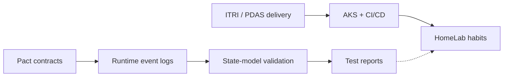
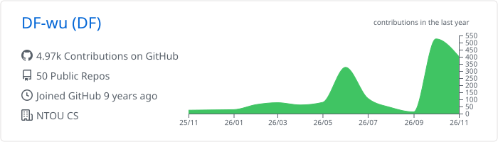
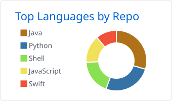
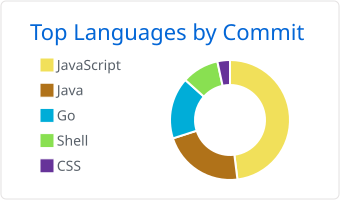
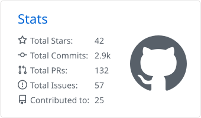
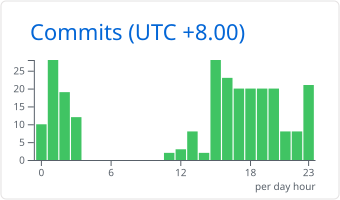

<a href="https://df.is-a.dev">
  <picture>
    <source media="(prefers-color-scheme: dark)" srcset="./assets/profile/banner-dark.svg" />
    <source media="(prefers-color-scheme: light)" srcset="./assets/profile/banner-light.svg" />
    
  </picture>
</a>

  
  
  
  
  

  <b>Backend · Platform · Event-driven systems</b> 
  M.S. / B.S. Computer Science and Engineering, National Taiwan Ocean University · Tainan, Taiwan

---

### Hi, I'm DF 👋

I am strongest where backend engineering meets operational reality: **event-driven systems, microservices, deployment, CI/CD, and data flow**, plus the question of whether a system can still be understood after it ships.

- 🔬 My thesis became **[CCTS](https://github.com/DF-wu/CCTS)**, a contract-testing service for event-driven microservices: **IEEE APSEC 2022** (first author) and **TCSE 2022 Best Chinese Paper**.
- 🏗️ At **ITRI / PDAS-team** I worked on personal-data authorization and payment systems delivered to **Azure Kubernetes Service**.
- 🖥️ I run a **home-lab with 30+ services** (storage, DNS, monitoring, media, home automation), so I live with my own operational decisions.
- 🌱 Open to **backend / platform engineering** roles.

<table>
  <tr>
    <td align="center" width="25%"><h3>2</h3>IEEE papers APSEC 2022 · ICS 2020</td>
    <td align="center" width="25%"><h3>🏆 1</h3>Best paper award TCSE 2022</td>
    <td align="center" width="25%"><h3>30+</h3>services operated in my home-lab</td>
    <td align="center" width="25%"><h3>15</h3>external merged PRs 180 merged PRs total</td>
  </tr>
</table>

Numbers from the public GitHub API/search and my public resume, refreshed 2026-11-16.

## 🧭 Selected work

<table>
  <tr>
    <td width="50%" valign="top">
      <h4>🔬 <a href="https://github.com/DF-wu/CCTS">CCTS</a> · Composite Contract Testing Service</h4>
      My thesis system: Pact contracts → runtime event logs → state-model validation → test reports, which catches missing transitions in event-driven microservices.  
      <b>Java · Spring Boot · RabbitMQ · MongoDB · Pact</b> — 8k+ LOC · APSEC 2022
    </td>
    <td width="50%" valign="top">
      <h4>💬 <a href="https://github.com/DF-wu/HideReplier">HideReplier</a></h4>
      Anonymous Discord reply bot for the NTOU CS community. It started as a Java/Spring Boot course project and was rewritten in Go with a Vite frontend, running on a 256MB Fly.io VM.  
      <b>Go · Vite · MongoDB · Docker · Fly.io</b> — ⭐ 10
    </td>
  </tr>
  <tr>
    <td width="50%" valign="top">
      <h4>🌡️ <a href="https://github.com/DF-wu/iDRACFanSpeedControl">iDRACFanSpeedControl</a></h4>
      Dell PowerEdge fan control over iDRAC/IPMI with ESXi, NVMe and GPU temperature inputs, Docker deployment, and a fail-safe audit.  
      <b>Shell · Docker · IPMI · ESXi · NVIDIA</b> — ⭐ 10 · R730XD tested
    </td>
    <td width="50%" valign="top">
      <h4>🏠 <a href="https://github.com/DF-wu/myServices">myServices</a></h4>
      The configuration and ops notes behind my home-lab: service composition, storage and network layout, MariaDB backup, Docker and server maintenance.  
      <b>Docker · Linux · NAS · MariaDB · SDN</b> — 30+ services in production at home
    </td>
  </tr>
  <tr>
    <td width="50%" valign="top">
      <h4>🎙️ <a href="https://github.com/DF-wu/CapsWriter-Offline-Container">CapsWriter-Offline-Container</a></h4>
      Maintained fork of an offline voice-input tool that also runs as a shared speech-to-text service on a NAS. Adds container packaging, CPU/GPU inference, and an OpenAI-compatible audio API.  
      <b>Python · Docker · CPU/GPU inference</b> — fork-v2.1.0
    </td>
    <td width="50%" valign="top">
      <h4>🗺️ <a href="https://df.is-a.dev">df.is-a.dev</a></h4>
      This profile as a website: an Astro site with ten switchable design systems, static JSON APIs, and a command palette. Source lives in <a href="./site"><code>site/</code></a>.  
      <b>Astro · TypeScript · CSS</b> — deployed via GitHub Pages
    </td>
  </tr>
</table>

<b>More experiments</b>

 

| Project | What it explores | Stack |
| --- | --- | --- |
| [BehaviorMonitor](https://github.com/DF-wu/BehaviorMonitor) | AI-assisted full-stack build: real-time UI, admin panel, analytics, Firebase backend | React 19, TypeScript, Firebase |
| [urlbalancer](https://github.com/DF-wu/urlbalancer) | Control-plane / data-plane separation and reverse-proxy service logic | Go, Gin, React, SQLite |
| [CCTS PoC services](https://github.com/DF-wu/CCTS_poc_orchestrator) | Orchestrator / [payment](https://github.com/DF-wu/CCTS_poc_payment) / [points](https://github.com/DF-wu/CCTS_poc_points) / [logging](https://github.com/DF-wu/CCTS_poc_logging) services used to validate CCTS | Java, Spring Boot, RabbitMQ |

## 📚 Research

Graduate research at **[SOSELab](https://soselab.cs.ntou.edu.tw/)** (Service-Oriented Software Engineering Lab), NTOU CSE, advised by [Prof. Shang-Pin Ma](https://soselab.cs.ntou.edu.tw/director/).
Thesis: **事件驅動微服務系統之契約測試暨端到端測試研究** (2022/7).

| | Work | Venue |
| :---: | --- | --- |
| 🥇 | [Testing for Event-Driven Microservices Based on Consumer-Driven Contracts and State Models](https://ieeexplore.ieee.org/document/10043304/) | **IEEE APSEC 2022** · first author |
| 🏆 | 事件驅動微服務系統之複合契約測試機制 | **TCSE 2022** · Best Chinese Paper Award |
| 📄 | [PDAS: A Digital-Signature-Based Authorization Platform for Digital Personal Data](https://ieeexplore.ieee.org/document/9359082/) | **IEEE ICS 2020** · co-author |
| 📄 | 數位個人資料授權之計價與雙向支付平台之系統設計 | NCS 2021 · co-author |
| 📄 | 基於數位簽章之個資授權平台設計 | TCSE 2020 · co-author |

## 💼 Experience

| | Role | Period |
| :---: | --- | --- |
| 🔬 | **Research Assistant · Thesis Author** at SOSELab, NTOU CSE Designed and built CCTS; IEEE APSEC 2022; TCSE 2022 Best Chinese Paper. | 2020 – 2022 |
| 🏗️ | **Software Engineer Intern** at ITRI · PDAS-team Personal-data authorization + valuation/payment platform: microservices, event-driven design, blockchain, fintech, CI/CD, AKS delivery. | Jul – Dec 2021 |
| 🏭 | **MIS / Internal Systems** at Ming-Chyuan Ltd. Maintains and modernizes digital systems for CNC manufacturing workflows. | 2012 – present |
| 🎓 | **Teaching Assistant** at National Taiwan Ocean University Migrated course content to a newer CMS workflow; supported lesson design. | 2020 – 2022 |
| 🌐 | **Open-source collaborator** · public OSS projects Integrations, webhook fixes, localization, and documentation correctness. | ongoing |

## 🛠️ Tech stack

  

<b>Also:</b> Gin · MariaDB · AKS · ESXi · Unraid · TrueNAS · Pact · JUnit · Postman · SideeX · contract testing · event-driven design · home-lab operations

## 🤝 Open-source trail

| PR | Repository | Contribution |
| --- | --- | --- |
| [#36](https://github.com/stanley2058/lilac-mono/pull/36) | `stanley2058/lilac-mono` | UUID delivery identities for GitHub webhooks and workflow cancellation |
| [#35](https://github.com/stanley2058/lilac-mono/pull/35) | `stanley2058/lilac-mono` | Link reply references on the configured GitHub host |
| [#13](https://github.com/stanley2058/lilac-mono/pull/13) | `stanley2058/lilac-mono` | Prevent `issue_comment` self-trigger loops |
| [#1](https://github.com/stanley2058/lilac-mono/pull/1) | `stanley2058/lilac-mono` | Exa web search provider and tests |
| [#138](https://github.com/Minidoracat/mcp-feedback-enhanced/pull/138) | `Minidoracat/mcp-feedback-enhanced` | Traditional Chinese localization and docs |

<b>More merged PRs</b>

 

| PR | Repository | Contribution |
| --- | --- | --- |
| [#4](https://github.com/stanley2058/lilac-mono/pull/4) | `stanley2058/lilac-mono` | Custom Tavily API endpoint support |
| [#5](https://github.com/stanley2058/lilac-mono/pull/5) | `stanley2058/lilac-mono` | Cleanup and documentation follow-up |
| [#1](https://github.com/stanley2058/lilac-ai-rag-dashboard/pull/1) | `stanley2058/lilac-ai-rag-dashboard` | Configurable OpenAI API base URL |
| [#111](https://github.com/yym68686/ChatGPT-Telegram-Bot/pull/111) | `yym68686/ChatGPT-Telegram-Bot` | Markdown table correctness fix |
| [#19293](https://github.com/is-a-dev/register/pull/19293) | `is-a-dev/register` | Custom domain registration |
| [#167](https://github.com/SrinivasanTarget/ContractTestingBoilerplate/pull/167) | `SrinivasanTarget/ContractTestingBoilerplate` | Corrected Pact broker port mismatch |
| [#691](https://github.com/flipperdevices/flipperzero-firmware/pull/691) | `flipperdevices/flipperzero-firmware` | Corrected firmware build documentation command |
| [#19](https://github.com/WayneChang65/ptt-crawler/pull/19) | `WayneChang65/ptt-crawler` | Typo fix |
| [#3](https://github.com/penut85420/TranslationImprover/pull/3) | `penut85420/TranslationImprover` | MIT license and English README |

## 📈 GitHub activity

  <picture>
    <source media="(prefers-color-scheme: dark)" srcset="./profile-summary-card-output/github_dark/0-profile-details.svg" />
    
  </picture>

  <picture>
    <source media="(prefers-color-scheme: dark)" srcset="./profile-summary-card-output/github_dark/1-repos-per-language.svg" />
    
  </picture>
  <picture>
    <source media="(prefers-color-scheme: dark)" srcset="./profile-summary-card-output/github_dark/2-most-commit-language.svg" />
    
  </picture>

  <picture>
    <source media="(prefers-color-scheme: dark)" srcset="./profile-summary-card-output/github_dark/3-stats.svg" />
    
  </picture>
  <picture>
    <source media="(prefers-color-scheme: dark)" srcset="./profile-summary-card-output/github_dark/4-productive-time.svg" />
    
  </picture>

<b>Star history</b>

 

<a href="https://www.star-history.com/?repos=DF-wu/iDRACFanSpeedControl,DF-wu/HideReplier,DF-wu/CapsWriter-Offline-Container,DF-wu/taobaoOrderExporter,DF-wu/lilac-mono&amp;type=date">
  <picture>
    <source media="(prefers-color-scheme: dark)" srcset="https://api.star-history.com/svg?repos=DF-wu/iDRACFanSpeedControl,DF-wu/HideReplier,DF-wu/CapsWriter-Offline-Container,DF-wu/taobaoOrderExporter,DF-wu/lilac-mono&amp;type=Date&amp;theme=dark" />
    <source media="(prefers-color-scheme: light)" srcset="https://api.star-history.com/svg?repos=DF-wu/iDRACFanSpeedControl,DF-wu/HideReplier,DF-wu/CapsWriter-Offline-Container,DF-wu/taobaoOrderExporter,DF-wu/lilac-mono&amp;type=Date" />
    
  </picture>
</a>

<b>WakaTime coding activity</b>

 

## 🎯 Where I fit

| Role | Why |
| --- | --- |
| **Backend Engineer** | CCTS, PDAS, and HideReplier cover APIs, messaging, persistence, event flows, and deployment. |
| **Platform Engineer** | Home-lab, AKS delivery, Docker/Linux/NAS operations, and iDRAC automation: I think about day two, not only day one. |
| **Systems-oriented SWE** | Research at SOSELab, delivery at ITRI, a decade of internal systems, and OSS work: practical architecture under real constraints. |

---

  <a href="mailto:df@dfder.tw">df@dfder.tw</a> ·
  <a href="https://df.is-a.dev">df.is-a.dev</a> ·
  <a href="https://github.com/DF-wu/resume/blob/main/CHUFEIWU_Resume.pdf">Resume</a> ·
  <a href="https://www.linkedin.com/in/chufei-wu-b33990164/">LinkedIn</a> ·
  <a href="https://soselab.cs.ntou.edu.tw/publications/">SOSELab publications</a>
    
  <i>"It's not a bug, it's a feature." — but I will still write the test for it.</i>
   
  Summary cards by <a href="https://github.com/vn7n24fzkq/github-profile-summary-cards">github-profile-summary-cards</a> · icons by <a href="https://skillicons.dev">skillicons.dev</a>

