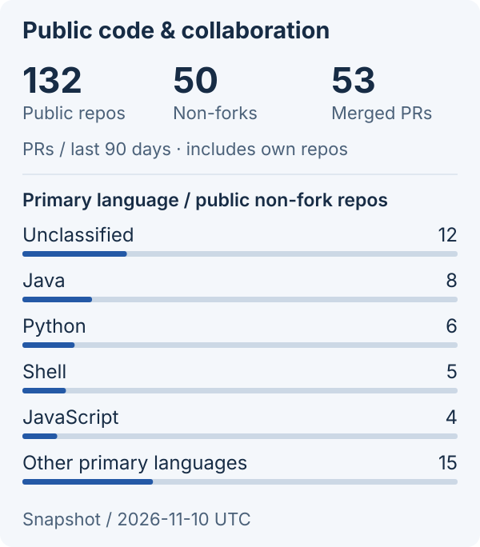
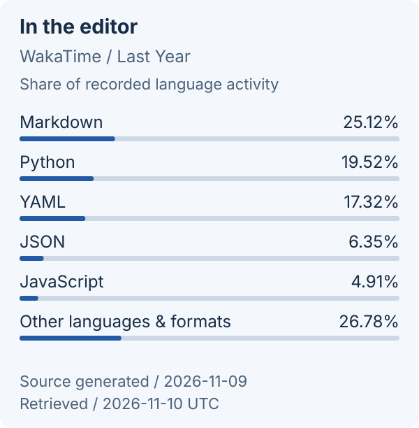

<picture>
  <source media="(prefers-color-scheme: dark)" srcset="assets/profile/hero-dark.svg" />
  
</picture>

# Chufei Wu / DF

**Backend & platform engineer · Taiwan** 
I build services, test the contracts between them, and care about what happens after deployment.

My work connects event-driven microservices, software-testing research, and hands-on Linux and container operations. I enjoy tracing a problem across those boundaries: from a message contract to a runtime event, from an application to the machine running it.

[Portfolio](https://df.is-a.dev) · [Résumé](https://github.com/DF-wu/resume/blob/main/CHUFEIWU_Resume.pdf) · [LinkedIn](https://www.linkedin.com/in/chufei-wu-b33990164/) · [Email](mailto:df@dfder.tw)

## Selected work

### [CCTS](https://github.com/DF-wu/CCTS) / Testing across service boundaries

My thesis system combines consumer-driven contracts, runtime event logs, and state models to verify event-driven microservice flows. It checks both message compatibility and whether execution follows the expected path.

**Java · Spring Boot · Pact · RabbitMQ · MongoDB** 
[Implementation & architecture](https://github.com/DF-wu/CCTS#architecture) · [APSEC 2022 paper](https://ieeexplore.ieee.org/document/10043304/)

### [HideReplier](https://github.com/DF-wu/HideReplier) / An application with an operating budget

An anonymous Discord reply application, now running on Go with a Vite frontend. Its documented runtime work includes streaming MongoDB results, atomic serial-number allocation, precompressed assets, and bounded connection pools for a small Fly.io VM.

**Go · MongoDB · Vite · Docker · Fly.io** 
[Build chain & runtime decisions](https://github.com/DF-wu/HideReplier#building-chain)

### [iDRAC Fan Speed Control](https://github.com/DF-wu/iDRACFanSpeedControl) / Hardware-aware automation

A Dell PowerEdge fan controller with pluggable temperature sources, a shared fan curve, diagnostics, and a path back to automatic control. The documentation states the tested hardware and compatibility limits explicitly.

**Shell · Linux · Docker · IPMI · ESXi** 
[Design & hardware limits](https://github.com/DF-wu/iDRACFanSpeedControl#how-it-works)

## Research & engineering foundations

I studied Computer Science and Engineering at **National Taiwan Ocean University (B.S. / M.S.)** and developed CCTS in **SOSELab**. My 2021 software engineering internship at **ITRI** involved personal-data authorization and valuation/payment systems, microservices, CI/CD, and delivery documentation. [Public résumé](https://github.com/DF-wu/resume/blob/main/CHUFEIWU_Resume.pdf)

- **APSEC 2022, first author:** *Testing for Event-Driven Microservices Based on Consumer-Driven Contracts and State Models.*
- **TCSE 2022, Best Chinese Paper:** composite contract testing for event-driven microservices.
- **ICS 2020, co-author:** *PDAS: A Digital-Signature-Based Authorization Platform for Digital Personal Data.*

[Publication records & award](https://ntou-soselab.github.io/SOSELab/publications.html) · [Graduate research record](https://ntou-soselab.github.io/SOSELab/people.html)

## Tools I work with

- **Services:** Java / Spring Boot, Go, Python; event-driven design and contract testing.
- **Data & messaging:** MongoDB, relational databases, Redis, RabbitMQ.
- **Delivery & operations:** Docker, Linux, CI/CD, Kubernetes / AKS, server and storage administration.

## Open source, in practice

I contribute integrations and fixes that make tools more useful and their documentation more dependable. A few merged examples:

- [Exa search provider & tests](https://github.com/stanley2058/lilac-mono/pull/1) in lilac-mono.
- [Traditional Chinese localization & documentation](https://github.com/Minidoracat/mcp-feedback-enhanced/pull/138) in mcp-feedback-enhanced.
- [Firmware build-command correction](https://github.com/flipperdevices/flipperzero-firmware/pull/691) in Flipper Zero firmware.

## Activity & working rhythm

### On GitHub

<picture>
  <source media="(prefers-color-scheme: dark)" srcset="assets/profile/github-dark.svg" />
  
</picture>

Public repositories, their primary languages, and merged PRs over 90 days. [Exact window & text data](assets/profile/metrics.md#github).

### In the editor / WakaTime

<picture>
  <source media="(prefers-color-scheme: dark)" srcset="assets/profile/wakatime-dark.svg" />
  
</picture>

My **Last Year** of recorded editor activity, including code, documentation, and configuration. Source and retrieval dates appear on the chart.

[Public WakaTime chart](https://wakatime.com/share/@cb2e708b-89d1-4093-bf95-cafd34987f43/d210fe3c-7b63-47b5-a4d4-b70bb8300fcb.svg) · [Text data & dates](assets/profile/metrics.md) · [Sources & refresh method](docs/profile/README.md)

---

**Let’s talk about services, testing, and the systems behind them.** 
[df@dfder.tw](mailto:df@dfder.tw) · [df.is-a.dev](https://df.is-a.dev)
